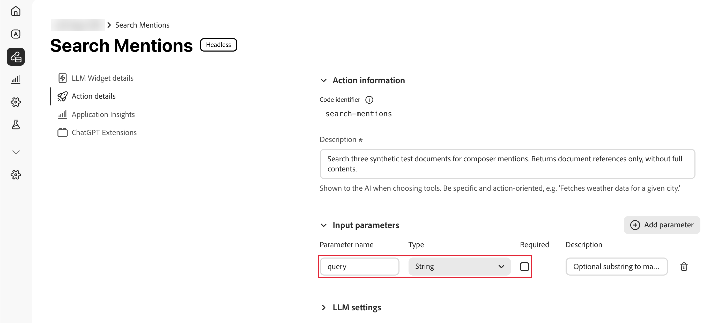

# 配置ChatGPT扩展 {#chatgpt-extensions}

>[!IMPORTANT]
>
>[!DNL Adobe LLM Apps]当前在Beta中。
>
>此处显示的功能、工作流和UI不一定表示产品的最终状态。 要加入Beta，请发送电子邮件至llm-apps-beta@adobe.com 。

**这些是仅限ChatGPT的扩展。** 它们未在[!DNL Claude]或其他LLM平台中配置功能。 您的应用程序仍然可以通过其标准操作和构件在这些平台上工作。

使用&#x200B;**[!UICONTROL ChatGPT扩展]**&#x200B;让用户直接打开您的应用程序，将其保留在对话旁边，查看支持的文件，或在撰写消息时查找项目。

**在本指南中：**&#x200B;了解如何配置这些可选功能，以及用户可以使用这些功能做什么。 例如，产品目录；请仅启用应用程序所需的功能。

屏幕截图中的红色轮廓突出显示步骤中使用的控件。 它们是文档注释，而不是UI错误指示器。

## 开始之前 {#before-you-begin}

您需要：

- 现有的LLM应用程序、编辑其操作的权限以及任务的工作操作。
- 已发布的用于直接打开或查看文件的构件。 纯文本操作可以提供提及搜索，但不能提供入口点。
- `@adobe/llm-apps-runtime` 1.3.0，对于小组件功能，`@adobe/llmapps-sdk` 0.2.1或更高版本支持。 需要时，请您的应用程序维护者确认这两个版本并更新提供的构件脚本。
- 连接的应用程序以及支持所选扩展的客户端。

>[!IMPORTANT]
>
>可用性因客户端而异。 文件入口点为&#x200B;**仅桌面**；作者提及内容需要&#x200B;**桌面或工作浏览器**。 OpenAI的Web支持列不包括经典[!DNL ChatGPT]。 在测试之前检查[平台支持](https://github.com/openai/mcp-extensions/blob/main/docs/spec.md#platform-support)。

>[!IMPORTANT]
>
>这些设置&#x200B;**不**&#x200B;构建文件查看器或实施搜索。 让您的维护者先准备所需的[操作](/help/guides/customize-handler.md)和[小组件](/help/guides/widgets.md)。

## 打开ChatGPT扩展 {#open-extensions}

1. 打开您的应用程序并选择&#x200B;**[!UICONTROL 操作]**。
1. 打开要配置的操作。
1. 选择&#x200B;**[!UICONTROL ChatGPT扩展]**&#x200B;选项卡。

在创建操作期间也可以使用该选项卡。 本指南使用已审阅的现有操作。

编辑后选择&#x200B;**[!UICONTROL 保存更改]**。 要发布配置，请按照[部署您的应用程序](/help/guides/deploy-your-app.md)和[刷新ChatGPT连接](/help/guides/test-in-chatgpt.md#refresh-after-app-changes)操作。

## 选择用户打开您的应用程序的位置 {#configure-entrypoints}

**entrypoint**&#x200B;是一个用户无需请求模型调用应用程序即可打开应用程序的地方。

>[!NOTE]
>
>可以为同一构件选择多个入口点。 入口点提供了其他打开它的方法；它们不会取代正常的聊天调用。 当模型可以使用该操作时，用户仍然可以在聊天中询问它并接收其构件。

1. 在&#x200B;**[!UICONTROL 入口点]**&#x200B;下，可以选择在&#x200B;**[!UICONTROL 图标URL]**&#x200B;中输入公共HTTPS图像URL。 该图标由此操作的入口点共享；请使用允许您发布的图像。
1. 在&#x200B;**[!UICONTROL 用户可以打开此应用]**&#x200B;下，为同一构件选择以下复选框的任意组合。 如果操作不需要直接打开，则保留全部未选中。

   | 类型 | 结果 |
   |---|---|
   | **[!UICONTROL 全局]** | 从导航中打开目录全屏 |
   | **[!UICONTROL 线程]** | 将目录作为对话旁边的选项卡打开 |
   | **[!UICONTROL 文件]** | 在自定义查看器中打开匹配文件 |

1. 对于“全局”或“线程”，请确认操作无需输入即可工作。
1. 对于文件，请完成以下设置。

例如，选择“全局”和“线程”从导航或对话旁边打开相同的目录小组件。 如果小组件支持文件查看，您也可以选择“文件”。 当文件与全局或线程组合时，对于`file`输入，将&#x200B;**[!UICONTROL 必需]**&#x200B;保留为未选中状态：文件启动项仍提供文件对象，但全局和线程启动项没有输入。 处理程序和小组件必须支持这两种情况。 仅文件操作可能需要`file`。

**预期结果：**&#x200B;从全局导航中打开目录，或作为“线程”的对话端选项卡。

### 从导航或对话中打开 {#test-global-thread}

以下用户提供的屏幕截图说明&#x200B;**Home**&#x200B;仪表板而不是目录示例。 导航和菜单的位置可能因客户端而异。

对于&#x200B;**全局**，请打开导航菜单，然后选择您应用程序的入口点。 在此示例中，入口点为&#x200B;**Home**。

确认功能板打开了全屏，并且导航边栏仍然可用。

对于&#x200B;**线程**，打开对话菜单，选择&#x200B;**[!UICONTROL 插件]**，然后选择入口点。 确认小组件在对话旁边打开，而无需新的提示。

### 在应用程序中打开支持的文件 {#file-entrypoint}

对于已准备的CSV目录查看器：

1. 选中&#x200B;**[!UICONTROL 文件]**&#x200B;复选框，选择&#x200B;**[!UICONTROL 添加扩展名]**，然后输入`.csv`。 将每个受支持的扩展添加到其自己的字段中。
1. 在&#x200B;**[!UICONTROL 操作详细信息]** > **[!UICONTROL 输入参数]**&#x200B;下，确认名为`file`且接受`name`和`resourceUri`的&#x200B;**对象**&#x200B;参数。 如果没有`file`参数，则选择“文件”将添加可选的对象输入；请检查任何现有的定义。 不需要其他输入。 如果还选择了“全局”或“线程”，则保留`file`为可选选项。
1. 在支持的桌面客户端中，使用您的应用程序打开一个非敏感的`.csv`文件。

**预期结果：**&#x200B;您的小组件显示文件。 此外，保存编辑内容需要实施编辑支持和可写文件。

>[!IMPORTANT]
>
>文件入口点与上载的文件参数不同。 它们会收到打开的文件资源引用，而不是上传下载URL或文件ID。

## 选择应用程序的显示方式 {#display-settings}

在&#x200B;**[!UICONTROL 显示模式]**&#x200B;下：

1. 将模型&#x200B;]**启动时的**[!UICONTROL &#x200B;显示设置为`inline`、`fullscreen`或&#x200B;**[!UICONTROL 无首选项]**。
1. 选择构件的&#x200B;**[!UICONTROL 支持的资源显示模式]**：内联、全屏或两者。 将这两个选项都保留为未选中状态以使用主机默认值。
1. 选择&#x200B;**[!UICONTROL 初始资源显示]**。 如果选择支持的模式，则必须包括初始模式。

这些是首选项；[!DNL ChatGPT]选择最终演示文稿。 全屏不创建侧面板选项卡：请为此使用线程入口点。

检查构件在广告的每个模式中是否保持可用。

## 让人们在编辑器中查找资源 {#composer-mentions}

通过作者提及，用户可在编写消息时搜索和选择目录项。 使用已返回可选搜索结果的操作。

1. 打开搜索操作并选择&#x200B;**[!UICONTROL 操作详细信息]**。
1. 确认名为`query`的&#x200B;**String**&#x200B;输入接受空文本，不含其他必需输入。
1. 在&#x200B;**[!UICONTROL LLM设置]**&#x200B;下，启用&#x200B;**[!UICONTROL 只读提示]**&#x200B;和&#x200B;**[!UICONTROL 在应用程序表面]**&#x200B;中显示为Widget。 搜索操作必须为只读。
1. 在&#x200B;**[!UICONTROL ChatGPT扩展]**&#x200B;中，打开&#x200B;**[!UICONTROL 启用作者提及]**。
1. 每个应用程序只允许一个提供程序。 如果替换旧提供程序，请在启用新提供程序之前禁用并保存旧提供程序上的提及内容。

**预期结果：**&#x200B;在应用程序的编辑器提及搜索中搜索已知产品，选择它，并确认消息中引用了预期的资源。

可见性设置使搜索操作对应用程序可用。 该提供商不需要自己的可视化构件。

以下示例使用&#x200B;**搜索提及次数**，该纯文本操作用于搜索合成文档而不是目录。 其`query`输入是&#x200B;**字符串**，未选中&#x200B;**必需**。

的可选字符串输入

在同一操作的&#x200B;**[!UICONTROL ChatGPT扩展]**&#x200B;选项卡中，**[!UICONTROL 启用作者提及]**&#x200B;已打开。

如果另一个操作已提供提及搜索，则切换将不可用，并且会出现一条警告来标识该操作。 在启用替换之前，禁用现有提供程序上的提及并保存。

## 其他ChatGPT小组件功能 {#additional-widget-features}

SDK还支持特定于ChatGPT的深层链接、扩展选择上下文、可编辑的草稿和对话定位。 这些需要构件实施，而不是此选项卡中的另一个开关。

| 如果您的小组件提供 | 尝试 |
|---|---|
| 指向项目的链接 | 打开链接，并确认显示目标产品 |
| 选择上下文 | 选择非敏感产品并询问相关问题 |
| 草稿或新对话控件 | 确认消息在预期位置打开，且草稿未自动提交 |

基本构件消息传送和其他标准SDK API并非仅限ChatGPT。 询问您的维护者您的小组件实施了哪些扩展；请参阅[SDK文档](https://www.npmjs.com/package/@adobe/llmapps-sdk)。

## 更改或删除扩展 {#change-or-remove}

在同一选项卡中，清除入口点的复选框或关闭&#x200B;**[!UICONTROL 启用作者提及]**。 如果没有剩余扩展名，则清除文件。 要删除共享图标，请选择&#x200B;**[!UICONTROL 清除图标]**。 要恢复显示默认值，请选择&#x200B;**[!UICONTROL 无首选项]**，清除支持的模式，然后选择&#x200B;**[!UICONTROL 主机默认值]**。

删除入口点不会删除操作或用户文件。 请参阅[字段定义和规则](/help/reference/reference-docs.md#chatgpt-extension-fields)。

## 疑难解答 {#troubleshooting}

| 您所看到的内容 | 要做什么 |
|---|---|
| 缺少一个或多个控件 | 检查[客户端支持](#before-you-begin)。 对于入口点，确认配置了构件。 这些扩展不适用于Claude或其他主机 |
| 将报表保存为不兼容的必需输入 | 全局/线程供应没有输入，文件供应`file`和提及供应`query`。 要求维护人员解决不匹配问题；请勿删除操作所需的输入 |
| 文件设置或查看失败 | 添加支持的扩展，确认对象`file`输入，并使用兼容的桌面客户端。 构件必须实施该文件格式 |
| 文件保存失败 | 确认编辑支持和写入权限。 协调冲突而不是覆盖较新的内容；减少超大内容 |
| 图标URL无法保存 | 输入有效的图像URL或数据URI，或清除可选图标。 首选公共HTTPS图像URL |
| 显示设置被拒绝或忽略 | 在支持的模式中包含初始模式。 ChatGPT控制最终演示 |
| 无法启用提及 | 检查只读行为、应用程序可见性和`query`输入。 在启用旧提供程序之前，保存旧提供程序的删除操作 |
| 搜索未返回任何项目或出错 | 尝试已知项目。 空结果可能有效；向搜索维护者报告缺少已知项目或错误 |
| 无法加载操作 | 在提供时使用&#x200B;**[!UICONTROL 重试加载应用程序操作]**&#x200B;或&#x200B;**[!UICONTROL 刷新应用程序操作]** |
| 草稿创建失败 | 检查客户端支持。 不自动发送预期为草稿的消息 |
| 缺少保存的更改 | 部署到已测试的环境，刷新连接，并确认发布构件更改 |
| 保存不支持的设置入口点块 | 选中受支持的“全局”、“线程”或“文件”复选框，或保留所有复选框 |

如需支持，请记录应用程序、环境、客户端、失败步骤和可见错误。 不包括令牌、私有URL或敏感数据。

## 后续内容 {#whats-next}

- [部署您的应用程序](/help/guides/deploy-your-app.md)
- [将LLM应用程序作为ChatGPT插件进行测试](/help/guides/test-in-chatgpt.md)
- [自定义生成的构件](/help/guides/widgets.md)
