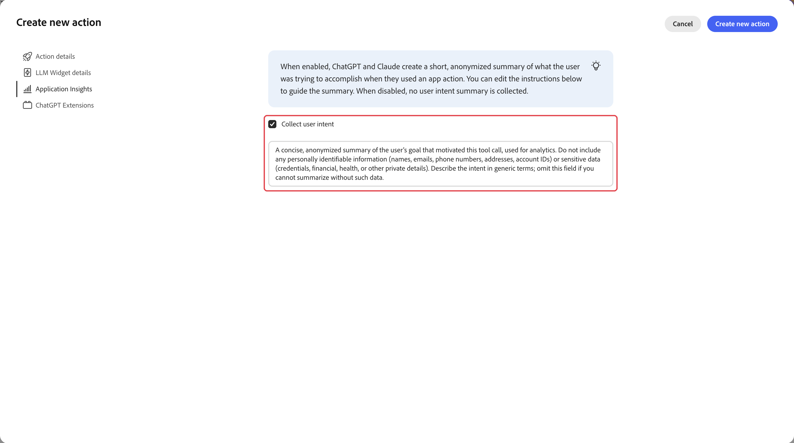
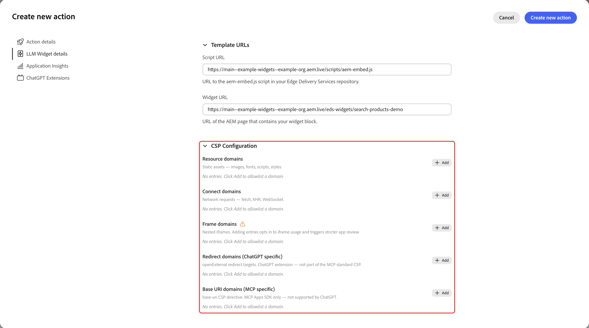

# 从头开始创建操作 {#create-action-from-scratch}

>[!IMPORTANT]
>
>所有AEM Sites Cloud Service客户都可以使用LLM应用程序来开发和管理自己的应用程序。 计数开始后，每个应用程序调用都将计入客户的AEM Sites内容请求。 Adobe将在计数生效之前公告计数率和开始日期。

>[!NOTE]
>
>本指南假定您基本熟悉Adobe Edge Delivery Services (EDS)。 如果您是EDS新手，请先阅读[EDS开发人员教程](https://www.aem.live/developer/tutorial)和[浏览块](https://www.aem.live/docs/exploring-blocks)以了解要点（块、`decorate`函数和EDS项目结构），然后再连接构件。

添加平台未创建的功能。 在[!DNL LLM Apps]中定义操作，在链接的存储库中编写其处理程序，并根据需要添加构件。

**在本指南中：**&#x200B;了解如何定义操作、实施其处理程序以及连接可选小组件。 在本地测试该操作，部署应用程序，然后在支持的LLM平台上尝试该操作。

对于您的第一个应用，从[基础结构设置](/help/guides/create-app.md)开始，然后[创建操作](/help/guides/creating-actions.md)。 创建操作指南介绍了从网站自动生成和手动创建的过程。

## 开始之前

您需要：

- 现有的LLM应用程序。
- 链接的处理程序存储库。
- 存储库的本地克隆及其依赖项已安装。
- EDS项目（如果操作显示构件）。
- 用于生产结果的清除API或数据源。

## 规划操作

围绕一个明确的用户任务设计每个操作。 在打开UI之前，定义：

- **意图** — 用户试图实现的目标。
- **描述** — 何时选择操作。
- **输入** — 用户需要的最少信息。
- **结果** — 处理程序返回的文本和结构化数据。
- **行为** — 操作是读取数据、更改数据还是调用外部系统。
- **小组件** — 结果是否需要可视化界面。

例如，将此计划用于&#x200B;**搜索产品**&#x200B;操作：

```text
Intent: Find products matching a category or search phrase
Inputs:
  category: optional string
  query: optional string
Result:
  content: text summary
  structuredContent: products and total count
Behavior: read-only, idempotent, open-world
Widget: product cards
```

将相关但不同的任务分开。 对于产品搜索和产品购买，请使用单独的操作，因为这两个任务具有不同的输入、风险和确认要求。

## 创建操作元数据

打开应用程序并选择&#x200B;**[!UICONTROL 操作]**，然后选择&#x200B;**[!UICONTROL 创建操作]**。

**[!UICONTROL 新建操作]**&#x200B;对话框有四个选项卡：**[!UICONTROL 操作详细信息]**、**[!UICONTROL LLM构件详细信息]**、**[!UICONTROL 应用程序分析]**&#x200B;和&#x200B;**[!UICONTROL ChatGPT扩展]**。 该对话框将在&#x200B;**[!UICONTROL 操作详细信息]**&#x200B;中打开。 保存的操作编辑器使用相同的选项卡。

可选的&#x200B;**[!UICONTROL ChatGPT扩展]**&#x200B;设置允许用户直接打开应用程序、使用自定义文件查看器，或在支持的客户端上的编辑器中查找资源。 在相应的操作和构件行为准备就绪后配置这些组件。 请参阅[配置ChatGPT扩展](/help/guides/chatgpt-extensions.md)。

### 输入操作信息和输入参数


在&#x200B;**[!UICONTROL 操作信息]**&#x200B;下，输入：

- **[!UICONTROL 操作名称]** — 简短的任务名称，如&#x200B;*搜索产品*。
- **[!UICONTROL 描述]** — 说明何时使用操作及其返回的内容。

该对话框从名称（如`search-products`）派生出&#x200B;**[!UICONTROL 代码标识符]**。 标识符在创建后即已修复，并且必须在应用程序中唯一。 使用处理程序文件夹的确切标识符。

有用的描述是具体的：

```text
Search the product catalog by category or keyword. Returns matching
products with their names, prices, categories, and image URLs.
```

避免模糊描述，如&#x200B;*获取产品信息*。 LLM平台使用说明来选择不同的操作。

在&#x200B;**[!UICONTROL 输入参数]**&#x200B;下，为处理程序接受的每个值选择&#x200B;**[!UICONTROL 添加参数]**&#x200B;一次。 对于每个参数，输入：

- **[!UICONTROL 参数名称]** — 处理程序收到的键。
- **[!UICONTROL 类型]** — 字符串、数字、整数、布尔值、对象或文件。
- **[!UICONTROL 必需]** — 操作是否需要该值。
- **[!UICONTROL 描述]** — 如何提取值。

对于&#x200B;**搜索产品**：

```text
category
  Type: String
  Required: No
  Description: Product category used to narrow the catalog.

query
  Type: String
  Required: No
  Description: Product name or search phrase.
```

使用稳定的参数名称。 更改名称还需要更改处理程序及其测试。

### 配置LLM设置

展开&#x200B;**[!UICONTROL LLM设置]**。 默认情况下，该部分处于折叠状态。


在&#x200B;**[!UICONTROL 注释]**&#x200B;下，只选择对操作为true的提示：

- **[!UICONTROL 破坏性提示]** — 该操作可以删除或永久更改数据。
- **[!UICONTROL 幂等（相同的参数=无额外效果）]** — 重复相同的请求具有相同的效果。
- **[!UICONTROL 开放世界提示]** — 该操作与外部系统通信。
- **[!UICONTROL 只读提示]** — 该操作不会更改数据。

例如，产品搜索通常为只读、幂等和开放世界。

在&#x200B;**[!UICONTROL OpenAI元数据]**&#x200B;下，输入在操作运行期间和完成之后显示的短信，每个短信最多可包含64个字符：

```text
Invoking status text: Searching products...
Invoked status text: Products found
```

在&#x200B;**[!UICONTROL 可见性]**&#x200B;下：

- **[!UICONTROL 公开到AI模型]**&#x200B;允许模型选择操作。
- **[!UICONTROL 在应用程序表面中显示为构件]**&#x200B;显示配置的构件。

可见性不选择构件类型。 对于纯文本操作，请在&#x200B;**[!UICONTROL LLM构件详细信息]** > **[!UICONTROL 构件类型]**&#x200B;下选择&#x200B;**[!UICONTROL 无交互式UI]**。

### 配置应用程序分析 {#configure-analytics}

打开&#x200B;**[!UICONTROL Application Insights]**。 默认情况下已选择&#x200B;**[!UICONTROL 收集用户意图]**：LLM平台将创建操作运行时用户尝试完成的简短匿名摘要。

如果您设置自己的[!DNL Adobe Analytics]或[!DNL Customer Journey Analytics]，则用户意图也会被发送到该处。 请参阅[设置Adobe Analytics和Customer Journey Analytics](/help/guides/analytics-setup.md)。

查看复选框下面的说明，该说明将指导摘要。 将它们限制为非敏感的、匿名的意图，并在您的隐私政策中描述您的数据收集。 说明最多可接受2,000个字符。 清除&#x200B;**[!UICONTROL 收集用户意图]**&#x200B;以不收集摘要。



有关完整的字段定义，请参阅[操作和小组件字段](/help/reference/reference-docs.md)。

## 配置构件

打开&#x200B;**[!UICONTROL LLM构件详细信息]**。 对于纯文本操作，在&#x200B;**[!UICONTROL 小组件类型]**&#x200B;下选择&#x200B;**[!UICONTROL 无交互式UI]**，并跳过其余小组件设置。


在&#x200B;**[!UICONTROL 小组件信息]**&#x200B;下，配置：

- **[!UICONTROL 构件类型]** — 为交互式构件选择&#x200B;**[!UICONTROL Edge Delivery Services块]**。
- **[!UICONTROL 构件域]** — 构件的沙盒来源。 UI会根据应用程序提交要求和每个应用程序的唯一性来标识它；它与EDS页面URL不同。
- **[!UICONTROL 小组件描述]** — 小组件呈现后模型显示的内容，最多512个字符。

构件描述与操作描述不同：

- **操作描述**&#x200B;可帮助模型决定何时调用操作。
- **构件描述**&#x200B;映射到`_meta["openai/widgetDescription"]`并汇总呈现的组件所显示的内容，从而减少重复旁白。

[!DNL LLM Apps]将构件描述作为组件元数据应用。 不要从处理程序返回描述。

展开&#x200B;**[!UICONTROL 模板URL]**&#x200B;并输入：

- **[!UICONTROL 脚本URL]** — EDS小组件入口点。
- **[!UICONTROL 小组件URL]** — 为此操作发布的EDS页面。

典型URL包括：

```text
Script URL:
https://main--<repo>--<owner>.aem.live/scripts/aem-embed.js

Widget URL:
https://main--<repo>--<owner>.aem.live/<widget-page>
```

在&#x200B;**[!UICONTROL CSP配置]**&#x200B;下，仅添加资产和网络请求所需的源。 如果加载外部资源的构件的CSP不完整，则可能不会呈现该构件。



如果EDS项目或构件页面尚不存在，请完成[自带EDS项目](/help/guides/bring-your-own-eds.md)，然后返回到操作。

## 保存操作

选择&#x200B;**[!UICONTROL 新建操作]**。 该操作将显示在带有&#x200B;**未部署**&#x200B;徽章的“操作”页面上。

保存将创建元数据，但操作仍需要处理程序。

重新打开保存的操作时，编辑器将显示相同的选项卡。 要保存以后的编辑，请选择&#x200B;**[!UICONTROL 保存更改]**。

## 实施处理程序

克隆链接的处理程序存储库并安装其依赖项：

```bash
npm install
```

创建：

```text
actions/
└── search-products/
    └── index.js
```

文件夹名称必须与操作编辑器中显示的操作的代码标识符匹配。

有关完整的结果合同和处理程序 — 小部件关系，请参阅[自定义生成的处理程序](/help/guides/customize-handler.md)。

### 处理程序合同

导出一个异步函数：

```javascript
module.exports = async (args) => {
  return {
    content: [
      { type: 'text', text: 'Response for the LLM platform.' }
    ],
    structuredContent: {
      // Data for the widget.
    }
  };
};
```

该处理程序接收在UI中定义的参数。

### 返回`content`

LLM平台将`content`读为文本回退：

```javascript
content: [
  { type: 'text', text: 'Found 3 matching products.' }
]
```

始终返回有用的`content`，即使操作具有小组件也是如此。

### 返回`structuredContent`

构件将`structuredContent`用作纯对象：

```javascript
structuredContent: {
  products: [
    { id: 'P-100', name: 'Product A', price: '$20' }
  ],
  total: 1
}
```

形状必须与EDS块从`bridge.toolResult`中读取的内容匹配。

### 连接API

在服务器端处理程序中保留API调用。 此示例调用公共产品API。 在名为`PRODUCT_API_ORIGIN`的[应用程序变量](/help/guides/app-variables.md)中配置API的HTTPS源。 该示例接受上面定义的`query`和`category`参数，至少需要一个参数，并且不需要凭据。

```javascript
const { getVariable } = require('@adobe/llm-apps-runtime');

module.exports = async ({ query = '', category = '' } = {}, extra) => {
  const normalizedQuery = typeof query === 'string' ? query.trim() : '';
  const normalizedCategory = typeof category === 'string' ? category.trim() : '';
  if (typeof query !== 'string' || typeof category !== 'string'
      || (!normalizedQuery && !normalizedCategory)
      || normalizedQuery.length > 200 || normalizedCategory.length > 100) {
    return {
      isError: true,
      content: [{ type: 'text', text: 'Enter a valid product search.' }],
      structuredContent: { products: [], total: 0 }
    };
  }

  const apiOrigin = getVariable(extra, 'PRODUCT_API_ORIGIN');
  if (!apiOrigin) {
    throw new Error('Product API configuration is unavailable.');
  }

  const origin = new URL(apiOrigin);
  if (origin.protocol !== 'https:') {
    throw new Error('Product API configuration must use HTTPS.');
  }

  const url = new URL('/v1/products', origin);
  if (normalizedQuery) {
    url.searchParams.set('query', normalizedQuery);
  }
  if (normalizedCategory) {
    url.searchParams.set('category', normalizedCategory);
  }

  const response = await fetch(url, {
    signal: AbortSignal.timeout(8000)
  });

  if (!response.ok) {
    throw new Error('Product service request failed.');
  }

  const payload = await response.json();
  if (!payload || !Array.isArray(payload.products)
      || !payload.products.every((product) =>
        product
        && typeof product.id === 'string'
        && typeof product.name === 'string'
        && typeof product.price === 'string')) {
    throw new Error('Product service returned an unexpected response.');
  }

  const products = payload.products.map((product) => ({
    id: product.id,
    name: product.name,
    price: product.price
  }));

  return {
    content: [
      { type: 'text', text: `Found ${products.length} matching products.` }
    ],
    structuredContent: {
      products,
      total: products.length
    }
  };
};
```

请勿在源代码、操作元数据、构件JavaScript、日志或面向用户的错误中放入API凭据。 **[!UICONTROL 变量和密码]** UI当前仅支持非敏感变量，不支持密码。 请勿在变量中存储API令牌。 如果您的上游API需要凭据，请在连接它之前安排已获批准的服务器端凭据机制。

对于生产代码，请在将批准的字段映射到`structuredContent`中之前验证完整的上游响应。

## 添加处理程序测试

创建匹配测试：

```text
test/
└── actions/
    └── search-products.test.js
```

至少测试：

- 输入有效。
- 输入缺失或无效。
- 结果为空。
- API超时或失败。
- API数据的格式不正确。
- 构件应具有`structuredContent`形状。

运行：

```bash
npm test
```

有关项目布局和本地MCP测试，请参阅[本地处理程序开发和测试](/help/reference/development.md)。

## 在本地测试操作

运行：

```bash
npm run dev:local
```

如果没有本地`actions.json`，服务器将发现具有最少元数据和无输入架构验证的处理程序。

使用MCP检查器或`curl`可以：

1. 列出已注册的操作。
2. 使用代表性参数调用新操作。
3. 验证`content`和`structuredContent`。
4. 测试无效和空请求。

## 连接并测试构件

如果操作具有构件：

1. 使构件读取处理程序的`structuredContent`。
2. 使用安全DOM API（如`textContent`）呈现外部值。
3. 添加加载、清空和错误状态。
4. 在本地预览EDS页面。
5. 验证CSP、CORS和小部件URL。

查看[自带EDS项目](/help/guides/bring-your-own-eds.md)。

## 部署和测试

1. 提交并推送处理程序和小组件更改。
2. [将应用程序](/help/guides/deploy-your-app.md)部署到暂存环境。
3. 在[ChatGPT](/help/guides/test-in-chatgpt.md)或[Claude](/help/guides/test-in-claude.md)中测试应用程序。
4. 使用与操作匹配的提示和不调用该操作的不相关提示验证操作选择。
5. 暂存成功后，部署到生产环境。

如果元数据不存在匹配的处理程序，则部署会使用默认存根注册操作。 添加处理程序，然后才能为用户执行该操作。
