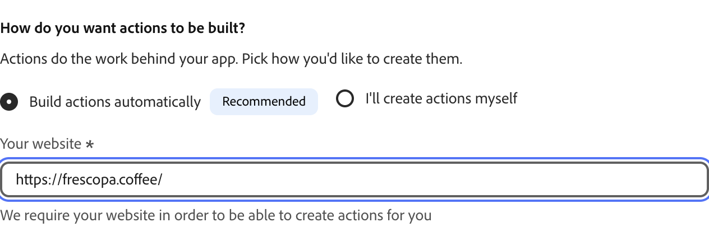
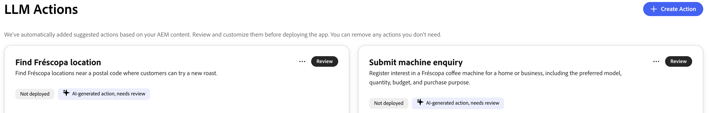
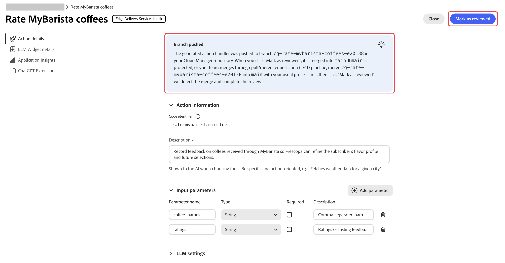

# 创建操作 {#creating-actions}

>[!IMPORTANT]
>
>所有AEM Sites Cloud Service客户都可以使用LLM应用程序来开发和管理自己的应用程序。 计数开始后，每个应用程序调用都将计入客户的AEM Sites内容请求。 Adobe将在计数生效之前公告计数率和开始日期。

操作是您的应用程序在LLM对话中提供的功能，例如查找产品、检查可用性或预订服务。 每个操作的处理程序都会执行相应的任务，而结果会由一个可选小部件显示。

在[基础结构设置](/help/guides/create-app.md)之后，选择如何从应用程序页面创建操作。 自动生成在[!DNL LLM Apps]托管的基础结构和您自己的存储库中均可用。

**在本指南中：**&#x200B;了解如何从您的网站生成操作或自己创建操作。 对于自动生成，请先启动该流程并查看结果，然后再部署和测试应用程序。

## 选择如何构建操作

打开您的应用程序。 如果Adobe仍在准备基础架构，请等待设置完成。

在&#x200B;**[!UICONTROL 操作]**&#x200B;部分中，**[!UICONTROL 您希望如何生成操作？]** 提供了两个选项：

| 选择 | 使用时机 |
|---|---|
| **[!UICONTROL 自动生成操作]** | 您希望平台分析您的网站并生成建议的操作、处理程序代码、测试和小组件。 这是建议的起点。 |
| **[!UICONTROL 我将自行创建操作]** | 您需要定义每个操作并自己提供其实施。 |

在“创建应用程序向导”中选择基础架构时，不会为您选择这两个选项中的任何一个。

## 从网站生成操作 {#generate-from-website}

1. 选择&#x200B;**[!UICONTROL 自动生成操作]**。
2. 在&#x200B;**[!UICONTROL 您的网站]**&#x200B;中，输入代表您品牌的产品、服务或客户任务的公共HTTPS网站。 此示例使用`https://frescopa.coffee/`。
3. 选择&#x200B;**[!UICONTROL 生成我的操作]**。

使用您有权分析的网站。 不要提供公开机密或受访问控制的信息的站点。

选择&#x200B;**[!UICONTROL 生成我的操作]**&#x200B;会开始生成；仅输入URL不会开始生成。 您无需重新创建应用程序或重新打开基础结构向导。

### 关注生成进度

应用程序页面显示&#x200B;**[!UICONTROL 操作正在生成]**。 选择&#x200B;**[!UICONTROL 转到操作]**&#x200B;或从导航中打开&#x200B;**[!UICONTROL 操作]**&#x200B;以跟踪进度。

UI预计生成最多需要30分钟。 离开页面，并在以后根据需要返回。

在生成期间，该平台：

1. 分析网站并确定应用程序的客户任务。
2. 创建建议的操作元数据，包括说明和输入参数。
3. 在操作存储库中生成服务器端处理程序和测试。
4. 在EDS存储库中生成构件。
5. 准备生成的操作以供审查。

平台分析网站时，“操作”页面显示&#x200B;**[!UICONTROL 发现对话体验的操作]**。 建议的操作将在平台发现时显示；它们的代码和小组件预览可能仍在生成。 等待生成完成，然后再检查每个操作。

>[!IMPORTANT]
>
>生成的处理程序最初使用代表性示例数据。 网站分析不会自动将您的应用程序连接到生产API、实时库存、付款服务或预订系统。

如果生成报告失败，请阅读可见错误并查看[疑难解答指南](/help/reference/troubleshooting.md)。 不要仅为了绕过生成错误而批准操作。

## 查看生成的操作 {#review-generated-actions}

在部署之前查看每个建议的操作。 确认它表示一项有用的任务，并且生成的行为与应用程序要执行的操作相匹配。

1. 在&#x200B;**[!UICONTROL 操作]**&#x200B;页面上，为就绪的操作选择&#x200B;**[!UICONTROL 审阅]**。
2. 查看操作的描述、输入参数、注释、可见性和生成的处理程序。
3. 查看构件配置并预览（如果操作包含构件）。
4. 检查生成的代码并进行测试。 使用[!DNL LLM Apps]托管基础结构，平台将打开拉取请求；使用您自己的存储库，平台将分支推送到每个存储库。 检查什么是示例行为以及必须使用实际集成替换的内容。
5. 操作就绪后，选择&#x200B;**[!UICONTROL 标记为已审阅]**。
6. 返回到操作列表，对其余操作重复此操作。

保存的操作编辑器将&#x200B;**[!UICONTROL 操作详细信息]**、**[!UICONTROL LLM构件详细信息]**、**[!UICONTROL 应用程序分析]**&#x200B;和&#x200B;**[!UICONTROL ChatGPT扩展]**&#x200B;分隔开。 在相应的选项卡中查看生成的构件和处理程序更改。

选择&#x200B;**[!UICONTROL 标记为已审核]**&#x200B;会在没有剩余的合并阻止程序时合并生成的更改：具有[!DNL LLM Apps]托管基础结构的拉取请求，具有您自己的存储库的分支。 如果打开的拉取请求阻止了审核，请解决阻止程序并重试。 不批准具有未解析的代码生成或合并失败的实施。

使用您自己的存储库，团队在选择&#x200B;**[!UICONTROL 标记为已审核]**&#x200B;之前，还可以将分支与其自己的进程（例如拉取或合并请求）合并。 如果平台无法合并分支本身（例如，由于目标分支受保护或分支存在冲突），则审核会显示要合并到哪个基础中的分支。 将其合并，然后再次选择&#x200B;**[!UICONTROL 标记为已审阅]**。

在复查所有生成的操作后，“操作”页面显示&#x200B;**[!UICONTROL 所有操作都已复查！]**。 若要返回应用程序，请选择&#x200B;**[!UICONTROL 转到应用程序页面]**。

审查不是部署。 在部署应用程序之前，无法通过应用程序的MCP服务器执行这些操作。

## 自行创建操作 {#manual-actions}

如果您不希望从网站生成操作，请执行以下操作：

1. 在应用程序页面的操作创建选择中，选择&#x200B;**[!UICONTROL 我将自行创建操作]**。
2. 选择&#x200B;**[!UICONTROL 我将创建我的操作]**。
3. 在“操作”页面上，选择&#x200B;**[!UICONTROL 创建操作]**。
4. 遵循[从头开始创建操作](/help/guides/create-action.md)以定义元数据、实施处理程序并根据需要连接构件。

基础设施保持不变。 选择手动创建不会为您创建处理程序代码或连接您的业务系统。

根据需要查看自动生成的操作后添加手动操作。

## 部署和测试

查看生成的工作后：

1. [将应用程序](/help/guides/deploy-your-app.md)部署到&#x200B;**[!UICONTROL 阶段]**。
2. 使用暂存MCP服务器URL在[ChatGPT](/help/guides/test-in-chatgpt.md)或[Claude](/help/guides/test-in-claude.md)中测试它。
3. 测试与每个操作匹配的提示以及不调用该操作的不相关提示。 检查文本响应和小组件交互。

在将应用提供给客户之前，请[自定义处理程序](/help/guides/customize-handler.md)以连接您的API，然后[自定义构件](/help/guides/widgets.md)。 在暂存环境中测试应用程序，以确认它可按预期工作。 仅在测试成功后部署到生产环境。
